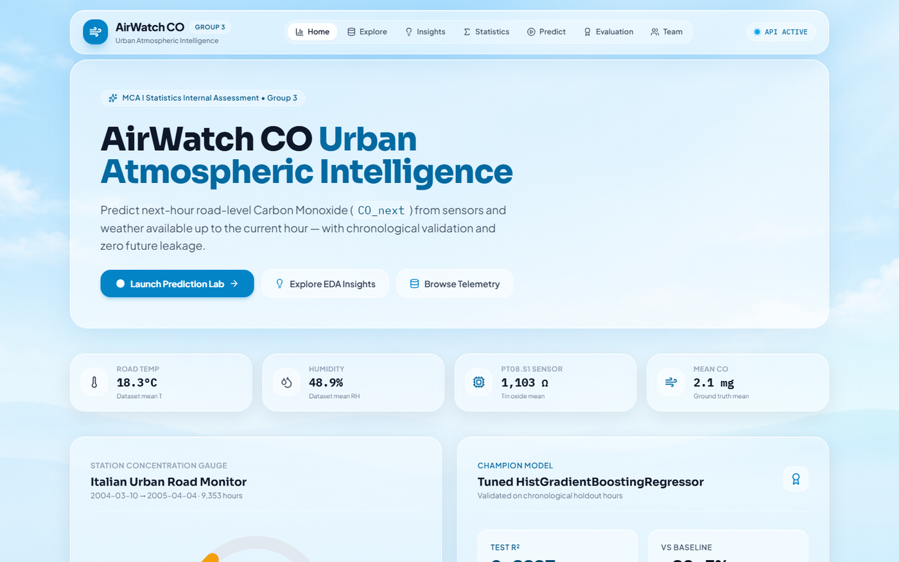
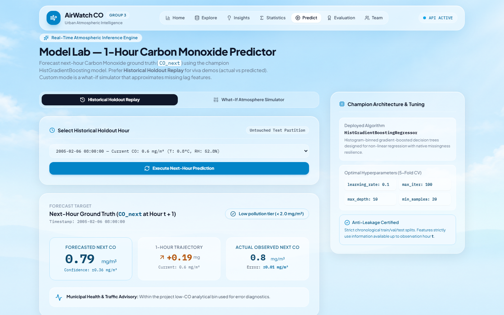
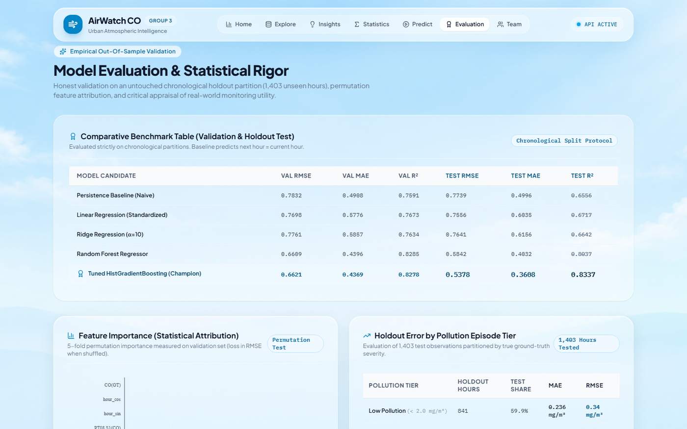
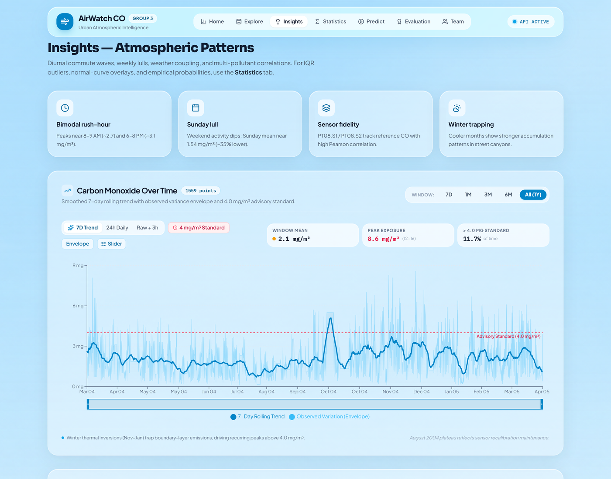
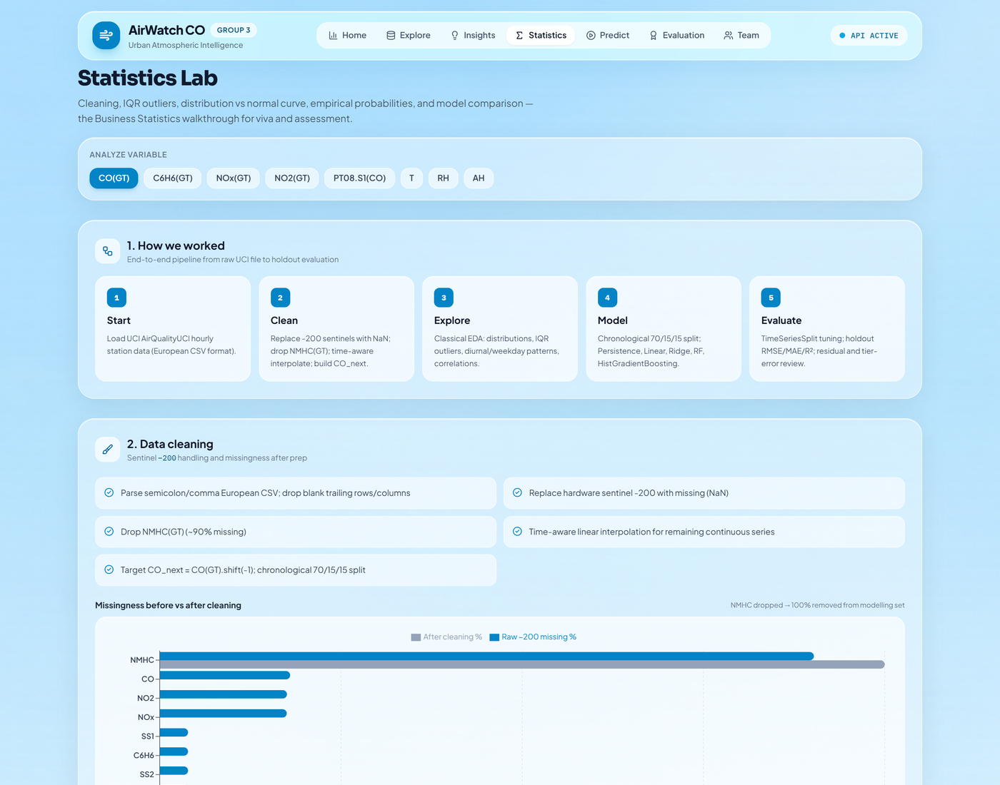
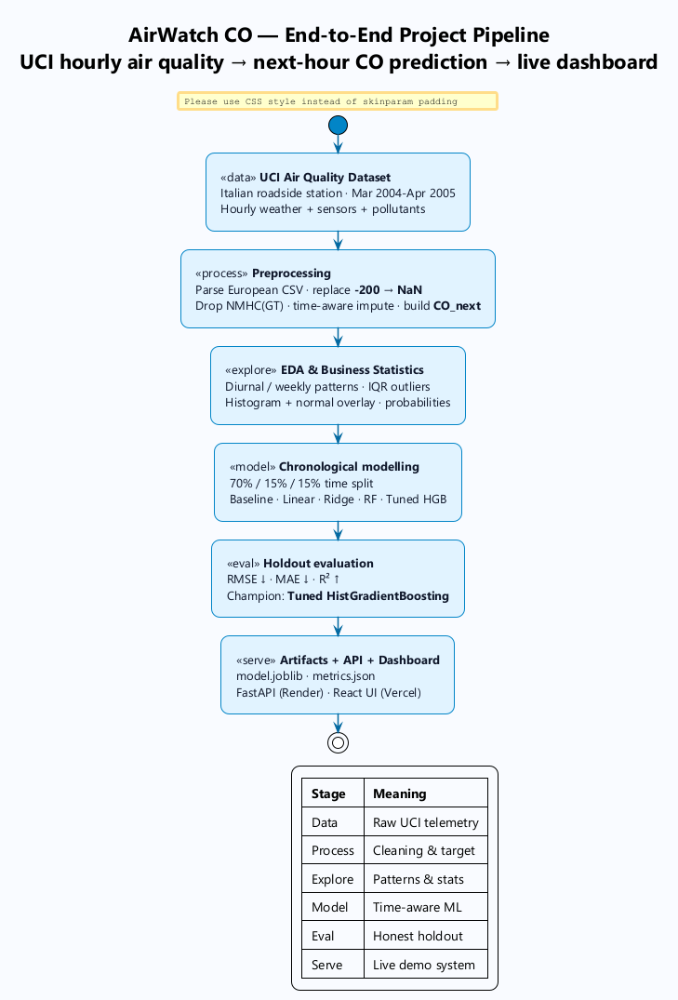
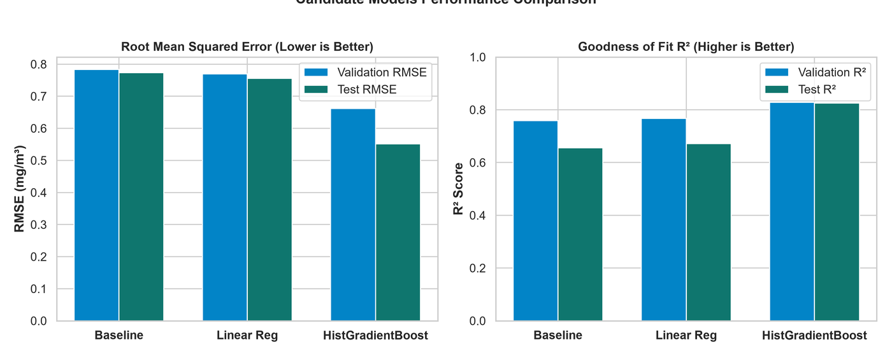
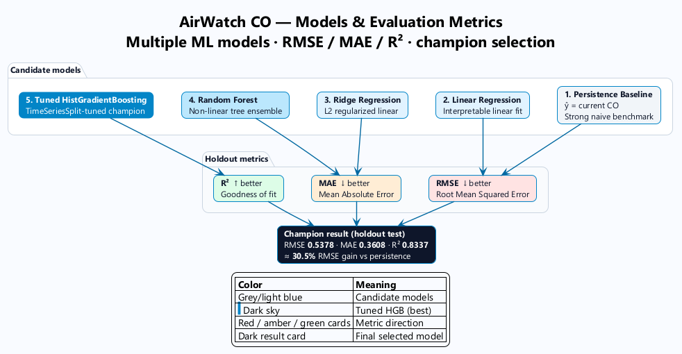

# AirWatch CO

**Urban Atmospheric Intelligence · MCA I Statistics · Group 3**

Predict **next-hour Carbon Monoxide** (`CO_next`) from the UCI Air Quality hourly station data — with chronological validation, classical Business Statistics, and a live FastAPI + React dashboard.

<p align="center">
  <a href="https://business-stats-air-quality-project.vercel.app"></a>
  &nbsp;
  <a href="https://business-stats-airquality-project.onrender.com/health"></a>
  &nbsp;
  <a href="reports/AIRWATCH_CO_FINAL_EXECUTIVE_SUMMARY.pdf"></a>
</p>

| | |
|--|--|
| **Dashboard** | https://business-stats-air-quality-project.vercel.app |
| **API** | https://business-stats-airquality-project.onrender.com |
| **Executive summary** | [`reports/AIRWATCH_CO_FINAL_EXECUTIVE_SUMMARY.pdf`](reports/AIRWATCH_CO_FINAL_EXECUTIVE_SUMMARY.pdf) |
| **Full statistics report** | [`reports/AIRWATCH_CO_FINAL_STATISTICS_REPORT.pdf`](reports/AIRWATCH_CO_FINAL_STATISTICS_REPORT.pdf) |

---

## Preview

<p align="center">
  
</p>

<p align="center">
  
  &nbsp;
  
</p>

<p align="center">
  
  &nbsp;
  
</p>

---

## What this project delivers

1. **Academic core (Python)** — notebooks for cleaning, EDA, modelling, and evaluation  
2. **Cleaned dataset + champion model** — artefacts ready for reproducible inference  
3. **Formal report package** — executive summary + full statistics report (MD / HTML / PDF)  
4. **Live demo system** — FastAPI backend + React glass UI (Explore · Statistics · Insights · Predict · Evaluation · Team)

**Research question:** Using only weather, sensors, and pollutants known up to hour *t*, can next-hour true `CO(GT)` be predicted **without temporal leakage**?

> **Critical data rule:** Hardware invalid codes are stored as **`-200`**. They must be treated as missing — never as real concentrations.

---

## Pipeline at a glance

<p align="center">
  
</p>

| Stage | What happens |
|-------|----------------|
| Data | UCI Air Quality hourly roadside series (Italy, Mar 2004 – Apr 2005) |
| Process | Replace `-200` → NaN · drop sparse `NMHC(GT)` · time-aware impute · build `CO_next` |
| Explore | Diurnal / weekly patterns · IQR outliers · Normal overlay · probabilities |
| Model | Chronological **70 / 15 / 15** · Persistence · Linear · Ridge · RF · Tuned HGB |
| Evaluate | Holdout RMSE · MAE · R² · honest error review |
| Serve | `model.joblib` + FastAPI (Render) + React UI (Vercel) |

---

## Champion results (holdout test)

Source of truth: [`artifacts/metrics.json`](artifacts/metrics.json)

<p align="center">
  
</p>

| Model | Test RMSE | Test MAE | Test R² |
|-------|----------:|---------:|--------:|
| Persistence baseline | 0.7739 | 0.4996 | 0.6556 |
| Linear Regression | 0.7556 | 0.6035 | 0.6717 |
| Ridge (α=10) | 0.7641 | 0.6156 | 0.6642 |
| Random Forest | 0.5842 | 0.4032 | 0.8037 |
| **Tuned HistGradientBoosting** | **0.5378** | **0.3608** | **0.8337** |

≈ **30.5%** RMSE improvement vs persistence · split is chronological **70% / 15% / 15%** with `TimeSeriesSplit` tuning.

<p align="center">
  
</p>

---

## Quick start (local)

### Prerequisites

| Tool | Recommended |
|------|-------------|
| Python | 3.11 or 3.12 |
| Node.js | 18+ LTS |
| Git | recent |

### Setup (once)

```powershell
git clone https://github.com/FarhanSayed16/Business_Stats_AirQuality_Project.git
cd Business_Stats_AirQuality_Project

python -m venv .venv
.\.venv\Scripts\Activate.ps1
pip install -r requirements.txt -r backend/requirements.txt

cd frontend
npm install
cd ..
```

### Run

**Windows one-click**

```powershell
.\start_project.ps1
```

**Or two terminals**

```powershell
# Terminal 1 — API
.\.venv\Scripts\Activate.ps1
uvicorn backend.app.main:app --reload --port 8000

# Terminal 2 — UI
cd frontend
npm run dev
```

| Service | URL |
|---------|-----|
| Dashboard | http://localhost:5173 |
| API health | http://localhost:8000/health |
| Swagger | http://localhost:8000/docs |

**Suggested demo path:** Home → Explore → Statistics → Insights → Predict → Evaluation → Team

### Verify

```powershell
.\.venv\Scripts\Activate.ps1
python test_backend_api.py
cd frontend; npm run build
```

More local detail: [`docs/RUN_LOCALLY.md`](docs/RUN_LOCALLY.md)

---

## Repository layout

```text
Business_Stats_AirQuality_Project/
├── dataset/air+quality/     # Original UCI files (do not edit)
├── data/cleaned/            # cleaned_air_quality.csv
├── notebooks/               # 01–04 academic notebooks
├── artifacts/               # model.joblib · metrics.json · schema
├── figures/                 # EDA / evaluation plots
├── backend/                 # FastAPI application
├── frontend/                # React · Vite · TypeScript · Tailwind
├── reports/                 # Executive summary + full report
├── docs/                    # Team briefs · diagrams · README shots
├── start_project.ps1 / .bat # Local launchers
└── test_backend_api.py      # API smoke tests
```

---

## Documentation map

| Document | Purpose |
|----------|---------|
| [`reports/AIRWATCH_CO_FINAL_EXECUTIVE_SUMMARY.pdf`](reports/AIRWATCH_CO_FINAL_EXECUTIVE_SUMMARY.pdf) | Professor hand-in summary |
| [`reports/AIRWATCH_CO_FINAL_STATISTICS_REPORT.pdf`](reports/AIRWATCH_CO_FINAL_STATISTICS_REPORT.pdf) | Full technical report |
| [`docs/TEAM_PROJECT_BRIEF.md`](docs/TEAM_PROJECT_BRIEF.md) | Teammate brief |
| [`docs/PROJECT_ONE_PAGER.md`](docs/PROJECT_ONE_PAGER.md) | One-page share sheet |
| [`docs/SYSTEM_AND_DECISIONS.md`](docs/SYSTEM_AND_DECISIONS.md) | Architecture & decisions |
| [`docs/DASHBOARD_WALKTHROUGH.md`](docs/DASHBOARD_WALKTHROUGH.md) | Live demo walkthrough |
| [`docs/PRESENTATION_TEAM_HANDBOOK.md`](docs/PRESENTATION_TEAM_HANDBOOK.md) | Viva / presentation pack |

---

## Group 3

| Name | Role |
|------|------|
| **Farhan Sayed** | System architecture · data engineering · API & dashboard |
| **Salman Khan** | Predictive modelling · prediction lab alignment |
| **Sahil Tambe** | Statistical analysis · exploratory data analysis |
| **Shruti Pawar** | Insights visualisation · figure consistency |
| **Aayesha Kaliwala** | Validation protocol · holdout metrics |
| **Kashish Maurya** | Documentation · report · presentation materials |

---

## Cloud deploy (already live)

The production demo is already deployed:

- **UI (Vercel):** https://business-stats-air-quality-project.vercel.app  
- **API (Render):** https://business-stats-airquality-project.onrender.com  

### Redeploy checklist (if you change code)

1. Push to GitHub `main`.  
2. **Render** — Python service from repo root  
   - Build: `pip install -r requirements.txt -r backend/requirements.txt`  
   - Start: `uvicorn backend.app.main:app --host 0.0.0.0 --port $PORT`  
   - Env: `ALLOWED_ORIGINS` = exact Vercel origin(s)  
3. **Vercel** — root directory `frontend`  
   - Env: `VITE_API_URL` = Render URL **with no trailing slash**

---

## Troubleshooting

| Problem | Fix |
|---------|-----|
| Imports / `uvicorn` fail | Activate `.venv`, reinstall deps, run from **repo root** |
| UI shows API offline | Start backend on `:8000`; hard refresh (`Ctrl+Shift+R`) |
| Cloud UI blocked by CORS | Set `ALLOWED_ORIGINS` on Render to the exact Vercel `https://…` origin |
| Cloud UI still hits localhost | Rebuild Vercel with `VITE_API_URL` set to Render |
| Predict fails locally | Confirm `artifacts/model.joblib` and `data/cleaned/cleaned_air_quality.csv` exist |
| Render cold start | Free tier may sleep; first request can take ~30–60s |

---

## Data credit

UCI Air Quality Data Set — S. De Vito et al. (CNR-ISAC, Italy). Used for academic coursework only.

---

<p align="center">
  <b>Group 3 · AirWatch CO</b><br/>
  Clone → setup → run · or open the <a href="https://business-stats-air-quality-project.vercel.app">live dashboard</a>
</p>
